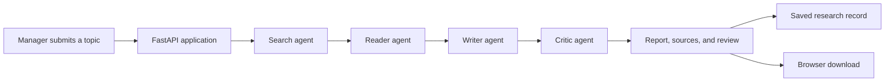

# Multi-Agent Research Assistant

- **Business problem:** Teams often spend too much time searching, reading, summarizing, and checking external information before producing a decision-ready report.
- **What this application does:** It turns a research question into a sourced report and a separate quality review.
- **Who it helps:** Analysts, strategy teams, consultants, managers, and subject-matter experts.
- **Primary benefit:** Faster, more consistent first drafts with clear separation between gathered evidence, final writing, and critical review.

## How the solution works



- The Search agent finds up to five relevant web sources.
- The Reader agent selects a useful source and extracts its main content.
- The Writer agent combines the evidence into an introduction, key findings, conclusion, and source list.
- The Critic agent scores the report and identifies strengths and areas for improvement.
- PostgreSQL keeps the topic, evidence, report, review, and creation time for audit and reuse.

## Business value

- **Reduces research turnaround:** Moves routine collection and first-draft work from hours toward an assisted workflow.
- **Adds a quality check:** A separate critic reviews the result instead of relying only on the original writer.
- **Improves traceability:** Search results and extracted source content remain available with the final report.
- **Creates repeatable output:** A shared process helps teams apply the same report structure across topics.
- **Keeps human control:** People decide how to use the output and should verify important facts before acting.

## Architecture and responsibilities

- **User experience:** A browser-based interface collects the topic, shows progress, displays results, and allows report download.
- **Application service:** FastAPI validates requests, starts the research workflow, and exposes health and research endpoints.
- **AI workflow:** LangChain coordinates specialist agents and prompt-based writing and review tasks.
- **External services:** Tavily provides web search; Google Gemini provides language model responses.
- **Data service:** SQLAlchemy stores completed work in PostgreSQL.
- **Source extraction:** Web content is cleaned and shortened before it is passed into the writer.

## Architectural considerations

- The workflow runs synchronously: the user waits until search, writing, review, and storage are complete.
- Storage is required; the service does not start without a valid PostgreSQL connection.
- API responses provide results and internal server logs capture detailed failures.
- Source quality, model limits, and web-page availability can affect accuracy.
- The critic is a second AI opinion, not a substitute for expert or editorial approval.
- Sensitive or regulated topics may require access controls, source approval, retention rules, and human review.

## Run locally

1. Create and activate a Python environment.
2. Install dependencies:

   ```bash
   pip install -r requirements.txt
   ```

3. Configure these environment variables:

   - `DATABASE_URL` - PostgreSQL connection string
   - `TAVILY_API_KEY` - Tavily search access
   - `GOOGLE_API_KEY` - Google Gemini access

4. Create the database table:

   ```bash
   python init_db.py
   ```

5. Start the application:

   ```bash
   python main.py
   ```

6. Open `http://127.0.0.1:8000`.
